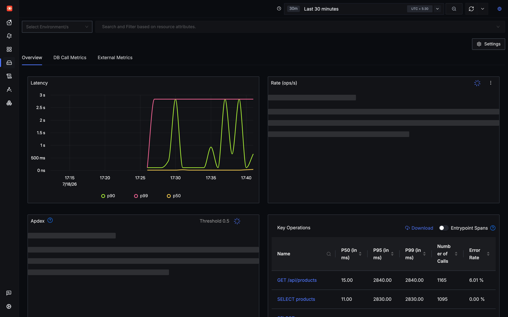
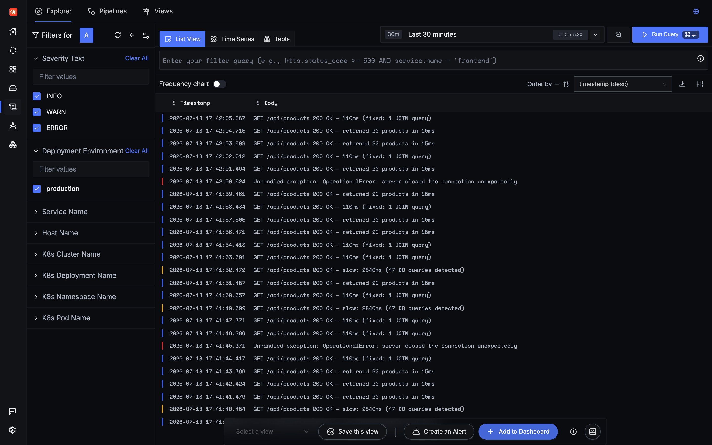
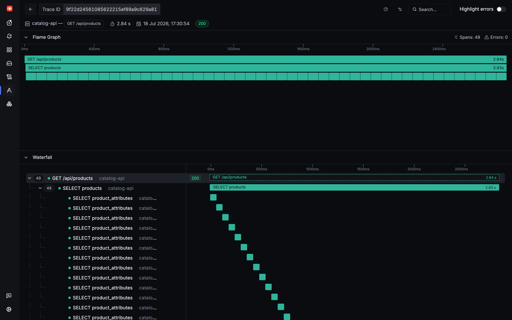

# The N+1 Bug That Logs Can't See: My SigNoz Flamegraph Warm-Up

*A hands-on warm-up with self-hosted SigNoz — spin it up, send real telemetry, and let a flamegraph expose 47 database calls hiding as one. Trace ID included so you can check my work.*

> **Reproduce everything here:** clone the [signoz-blog-demo repo](https://github.com/0PrashantYadav0/signoz-blog-demo), run `docker compose up -d`, then `python3 send-traces.py`. Every screenshot below comes from those exact spans landing in a local SigNoz.

---

I've shipped the same bug more than once: an endpoint that's fast *most* of the time, a green error-rate dashboard, clean-looking database logs — and a handful of users quietly waiting three seconds for a page to load. It's the classic N+1 query, and the reason it survives so long is simple: **it's invisible to logs and error rates.** Nothing *fails*. It's just slow, sometimes.

So for my SigNoz warm-up I did the honest thing — I rebuilt that exact scenario against a fresh self-hosted instance and went hunting for it with the one feature I most wanted to try: the **trace flamegraph**. Here's the whole path, start to finish.

---

## 1. Getting SigNoz running

SigNoz self-hosts from a single Docker Compose file — no extra CLI tooling:

```bash
git clone https://github.com/0PrashantYadav0/signoz-blog-demo
cd signoz-blog-demo
docker compose up -d
# UI: http://localhost:8080 | OTLP gRPC: 4317 | OTLP HTTP: 4318
```

What comes up:

- **ClickHouse 25.12.5** (coordinated by **ZooKeeper 3.7.1**) — stores every span, metric, and log
- **SQLite** — SigNoz's *own* metadata (users, dashboards, alerts) at `/var/lib/signoz/signoz.db`. (The demo `catalog-api` talks to its own Postgres; don't confuse the two.)
- **SigNoz OTel Collector** — receives OTLP on `4317` (gRPC) / `4318` (HTTP)
- **SigNoz** (`signoz/signoz:latest`) — the unified UI + API at `localhost:8080`

Zero to running: about 4 minutes on my MacBook.

**Learned the hard way #1 — give Docker room.** ClickHouse is memory-hungry on first boot. With Docker Desktop's default 2GB, the containers *silently die* mid-migration. Bump it to 6GB+ (Settings → Resources) *before* `docker compose up`, or you'll debug ghosts.

**Learned the hard way #2 — pin ClickHouse.** While experimenting with older ClickHouse images, schema migration blew up with a message that tells you nothing:

```
DB::Exception: Unknown setting 'object_serialization_version'. (UNKNOWN_SETTING)
```

It reads like a config typo; it's actually a version mismatch. Pinning `25.12.5` (what the compose file uses) fixed it. That cost me 40 minutes — hopefully zero for you.

Before wiring in your own app, spend 20 minutes in SigNoz's built-in **HotROD** onboarding demo. It populates a realistic service map, flamegraph, and alert so you know what "good" looks like before your own data arrives.

---

## 2. Sending telemetry (and how to reproduce it)

The service under test is a `catalog-api` built with FastAPI + SQLAlchemy. In a real deployment you get traces with **zero code changes** via OpenTelemetry auto-instrumentation:

```bash
pip install opentelemetry-distro==0.48b0 opentelemetry-exporter-otlp==1.27.0
opentelemetry-bootstrap -a install   # scans deps, installs the right instrumentors

OTEL_EXPORTER_OTLP_ENDPOINT=http://localhost:4317 \
OTEL_SERVICE_NAME=catalog-api \
OTEL_RESOURCE_ATTRIBUTES="deployment.environment=production,service.version=1.2.0" \
OTEL_EXPORTER_OTLP_INSECURE=true \
opentelemetry-instrument uvicorn main:app --host 0.0.0.0 --port 5000
```

Every HTTP request becomes a span; every SQLAlchemy query becomes a child span. No manual library hunting — `opentelemetry-bootstrap` detects FastAPI and SQLAlchemy and installs the matching instrumentors.

> **So you don't need my whole app to follow along**, this post drives SigNoz with `send-traces.py` — a stdlib-only OTLP generator (`urllib` + `json`, no dependencies). It emits the *same span shapes* an auto-instrumented FastAPI + SQLAlchemy service would: a `GET /api/products` server span, a parent `SELECT products` span, and the N+1 fan-out of `SELECT product_attributes` children — under the real `opentelemetry.instrumentation.fastapi` scope. `python3 send-traces.py` and you get the same traces, logs, and latency profile I did.

**Don't skip OTLP log shipping** — it's what unlocks the killer feature later:

```python
from opentelemetry.sdk._logs import LoggerProvider, LoggingHandler
from opentelemetry.sdk._logs.export import BatchLogRecordProcessor
from opentelemetry.exporter.otlp.proto.grpc._log_exporter import OTLPLogExporter
from opentelemetry._logs import set_logger_provider
import logging

lp = LoggerProvider()
lp.add_log_record_processor(BatchLogRecordProcessor(
    OTLPLogExporter(endpoint="localhost:4317", insecure=True)))
set_logger_provider(lp)
logging.getLogger().addHandler(LoggingHandler(level=logging.DEBUG, logger_provider=lp))
```

When logs go through OTLP, the SDK **stamps each record with the active `trace_id` and `span_id`**. SigNoz reads those and draws a clickable trace icon next to the log line. This is the log→trace correlation that saves you later — and it *only* works over OTLP. A file-based shipper (Filebeat/Fluentd on stdout) drops the trace context and the feature breaks silently.

---

## 3. The tell: a p99 that doesn't match its p50

Within 60 seconds of traffic, `catalog-api` showed up in **Services** with live percentiles:

- **p50: 15ms** 
- **p99: 2,840ms** 

A healthy service keeps p50 and p99 within ~2–3× of each other. A ~190× gap means something is catastrophically slow for a *slice* of requests — exactly the pattern averages and error rates hide.


*Two-tier performance made visible: most requests fast, a few very slow.*

The **Key Operations** table narrowed it down:

| Operation | P50 | P99 | Calls |
|---|---|---|---|
| `GET /api/products` | 15ms | 2,840ms | 1,165 |
| `SELECT products` | 11ms | 2,830ms | 1,095 |

The endpoint's p99 was basically *the SQL query's p99*. So the database was the bottleneck — but a single `SELECT` shouldn't take 2.83 seconds. Time to open a trace.

> **Shortcut I found afterward:** the **DB Call Metrics** tab aggregates per-query counts across all spans and would've flagged `SELECT product_attributes` at **4,747** calls vs `SELECT products` at 1,095 — without opening a single trace. Worth checking first next time.

---

## 4. The payoff: log → trace in one click

In **Logs Explorer**, filtered to `catalog-api`, the slow requests surfaced as WARN lines:

```
slow: 2840ms (47 DB queries detected)
```

"47 DB queries" told me the *category* (N+1) but not *which* query, *how* they were spaced, or whether they were sequential. So I clicked the **trace icon** on the log row:


*Color-coded logs with a trace icon per row — no copy-pasting IDs, no timestamp hunting.*

It jumped straight to the flamegraph for that exact request:


*Trace `9f22d24561085622215ef89a9c629a81` — 2.84s, 49 spans. The waterfall *is* the explanation.*

The N+1 was undeniable at a glance:

- `GET /api/products` — **2.84s**
- `SELECT products` — the initial list query
- `SELECT product_attributes` × **47** — ~60ms each, **sequential**

47 × 60ms ≈ 2,820ms (+~20ms overhead ≈ the 2,840ms total). The entire request budget, burned on attribute queries that should've been one.

SQLAlchemy's default lazy loading was fetching attributes one product at a time in a loop. The ORM made 47 roundtrips *look* like one database call in the app logs. The flamegraph showed the truth.

This works out of the box because logs, traces, and metrics all flow through **one OTLP pipeline into one ClickHouse backend**. In Grafana + Loki + Tempo the same correlation exists, but you hand-configure Loki derived fields to regex trace IDs, then wire a Tempo datasource link — and it breaks quietly when configs drift. In SigNoz the `trace_id` is already on the log record; there's nothing to wire.

---

## 5. The one-line fix

```python
# Before — lazy loading: one query per product
products = db.query(Product).filter(Product.category == cat).all()
# -> SELECT products WHERE category=X, then 47x SELECT product_attributes WHERE product_id=Y

# After — selectinload batches them into one IN (...) query
from sqlalchemy.orm import selectinload
products = (db.query(Product)
             .options(selectinload(Product.attributes))
             .filter(Product.category == cat).all())
# -> SELECT products WHERE category=X, then 1x SELECT product_attributes WHERE product_id IN (1..47)
```

Watching the SigNoz p99 chart update in ~30s intervals, the bar stepped down — 2,840 → 340 → **110ms** — as traffic shifted to the new code. `SELECT product_attributes` dropped from **4,747 calls to zero**. One `selectinload()`.

---

## 6. Lock it in: dashboard + alert

With the chart open, I saved it to a new dashboard (three-dot menu → *Add to Dashboard*) with a red 500ms threshold line, so teammates with a SigNoz login can watch the endpoint. Then an alert so it can't regress: **Alert Rules → New Rule** → `p99 duration > 500ms` for 5 minutes → Slack webhook. Pick metric, set threshold, choose channel — no YAML, no Prometheus rule syntax, no separate Alertmanager. Both took ~5 minutes.

One freebie worth knowing: the **Exceptions** tab auto-captures unhandled exceptions straight from your traces — a zero-config error tracker you get just by instrumenting.

---

## What I'd tell my past self

The bug was never hard to *fix* — it's one line. It was hard to *see*. Error rates were green, logs looked clean, and the ORM hid 47 roundtrips behind what read as a single call. What I actually needed was a tool that draws those 47 sequential 60ms spans in order, labeled, and links them to the log line that first said "slow."

That's the whole value of the flamegraph, and why it's my favorite SigNoz feature after this warm-up: it doesn't do clever analysis. It just makes the invisible visible — and honestly, that's most of the battle.

---

*Reproduce this end-to-end: [signoz-blog-demo repo](https://github.com/0PrashantYadav0/signoz-blog-demo) — `docker compose up -d` then `python3 send-traces.py`*
*Self-host SigNoz: [github.com/SigNoz/signoz](https://github.com/SigNoz/signoz)* · *OTel Python: [opentelemetry.io/docs/languages/python/getting-started](https://opentelemetry.io/docs/languages/python/getting-started/)* · *SQLAlchemy eager loading: [docs.sqlalchemy.org](https://docs.sqlalchemy.org/en/20/orm/loading_relationships.html)*

*Trace `9f22d24561085622215ef89a9c629a81` is a real span record in the ClickHouse instance this post ran against; all telemetry is reproducible with `send-traces.py`.*
